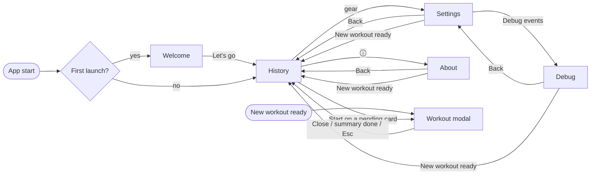

# Screens

Map of the app's screens and how the player moves between them. Each screen's behaviour is specified in its feature note; this note only fixes the structure. Pencil frames follow the names in [[#Frames]].

## Window
- **Desktop**: 1280 × 800 logical pixels by default, like the League client's own window. Meant to be readable from a distance while exercising (big numbers).
- One window. No overlay in the MVP (see [[Vision]]).

## Layout
```
┌────────────────────────────────────┐
│ ⧗ COOLDOWN.LOL ● Connected · Lobby ⚙ⓘ│  top bar
├────────────────────────────────────┤
│                                    │
│              History               │
│        (or Settings / About)          │
│                                    │
│                                    │
└────────────────────────────────────┘
```
- **No sidebar.** **History** is the main screen and takes the full width, with 32 px margins. About and Settings use a 720 px column centred in the window; Welcome a 560 px column centred both ways.
- **Top bar** (52 px), on every screen except Welcome:
  - on the left, a 36 px **leading slot** and a **headline**, as in a Material app bar. On History, they hold the Mark and the "COOLDOWN.LOL" wordmark (`.LOL` in `accent`). On a pushed screen, the **back arrow** takes the Mark's place, with the tooltip "Back to History (Esc)", and the title of the current screen ("SETTINGS") takes the wordmark's place. Nothing else in the bar moves. History has no back arrow. See [[#Navigation]].
  - on the right, the connection dot and client phase (replaces the current [[Client status]] card), a **Settings** button (gear) and an **About** button (ⓘ).
  - The button of the screen being shown is marked with a `border` background and a `text-primary` icon. Having no label, each button is named by its tooltip: "Settings", "About", "Back to History (Esc)" ([[Tokens#Tooltip]], frames `Top bar / Tooltip / *` in `History components`).
- The window opens on **History**.
- **Workout modal**: when a game ends and its workout is ready, a **prompt** opens over History, like a matchmaking "match found" prompt: a centred dialog with a big round **Start workout** button, what is due, and Later / Skip workout (see [[Post-game workout#Prompt ("Workout ready")]]). Once started, the steps open as a **sheet** rising over History: full width, from just under the top bar to the bottom of the window, rounded top corners, header "POST-GAME WORKOUT" and a close button (×). Closing it returns to History. From any other screen, the app goes back to History first ([[#Navigation]]).

## Navigation
A stack of screens with History at the bottom, and modals kept apart from it, as on iOS and Android. The rules and their reasons are in [[ADR-0018 Navigation stack]].
- **History** is the root. **Settings** and **About** are pushed from the top bar buttons. **Debug** is pushed from Settings.
  - A top bar button pops back to its screen if that screen is already in the stack. Otherwise it pops back to History, then pushes its screen. The stack is therefore always `History › Settings › Debug` or `History › About` at most.
  - Clicking the button of the screen being shown does nothing.
- **Welcome** is shown alone at first launch. "Let's go" replaces it with History, and going back never returns to it.
- **Back**:
  - inputs: the back arrow of the top bar, **Esc**, **Alt+←** (**⌘[** on macOS) and the mouse back button;
  - Back closes the open modal first, otherwise it returns to the screen below. On History it does nothing: it never closes the window.
  - There is no forward move.
- **Screens below are kept**: back on History, the scroll position, the opened rows and the Games/Workouts view are as the player left them. A pushed screen starts at the top each time it opens.
- **Modals** (uninstall confirmation, workout prompt, workout steps) sit over the current screen, one at a time.
  - Esc does what their way out does: Cancel, Later, Close (×).
  - A click on the scrim never closes them.
- **Navigation changes on its own only when a workout is ready**: from any screen, the app goes back to History, then opens the prompt. If the uninstall confirmation is open, or Welcome is shown, the prompt waits until it is closed. Showing the window from the notification area or a second launch keeps its screen.
- **Screen titles** are in the top bar's headline. Settings, About and Debug no longer repeat them, and no longer have a "‹ History" link, in their content.
- **Transitions**: pushing a screen slides it in by 30 px from the right while it fades in, and going back plays the same move in reverse. Meanwhile, the leading slot fades through, and a cursor erases the headline, then types the next one. The cursor is a block in `accent`. It erases at 10 ms per character and types at 18 ms per character, each phase in 150 ms at most, then it stays 120 ms and goes. See `App shell / Top bar / Headline transition`. A modal fades in its scrim and lifts its content. Each lasts `motion-medium` (200 ms), easing out. There is no transition, no cursor and no typing when Windows' Animation effects setting is off.
- **Window title**: "cooldown.lol" on History and Welcome, "Settings — cooldown.lol" and "About — cooldown.lol" on the pushed screens.
- A link that goes forward ends with a chevron →. Only Back uses ←.

## Screens
| Screen | Access | Content | Feature |
|---|---|---|---|
| **Welcome** | first launch only (no top bar) | Shown once, at first launch: the principle (main stat → burpees, secondary stat → squats, deaths → plank), the health warning, Riot's disclaimer, a "Let's go" button | [[First launch]] |
| **History** | main screen, default | All games grouped by session, newest first, one row per game, in a Games view (stats) or a Workouts view (exercises). Also shows the game that just ended while its workout is computed, and games without a workout | [[History]] |
| **Workout** (modal over History) | on its own, or Start on a pending card | Opens on its own when a workout is ready, or from **Start** on a pending card: prompt → steps → summary. All its states are in [[Post-game workout]] | [[Post-game workout]] |
| **Settings** | gear in the top bar | Opt-in error reports: "Send crash reports" and "Send all logs" switches, off by default, and the 30-day retention note; on alpha builds, the update status and **Check now** | [[Settings]], [[Auto-update]] |
| **About** | ⓘ in the top bar | `AboutSlint` (required, see [[ADR-0001 Native UI with Slint]]), Riot's "Legal Jibber Jabber" disclaimer, app version | — |

The computation of every number stays **inline** in each workout step (stat, target, cap) and in an expanded History card: there is no detail screen.

Later (not in the MVP): difficulty and targets in Settings. Unbuilt screens are not shown, not even disabled.



## Frames
In `design/cooldown.pen`, at 1280 × 800 (the installer at 420 × 500). The `App shell / Settings / *` frames lost their content in the move to 1280 × 800: the app keeps the Settings layout of the earlier frames, in the About column. The History screens are instances of the `App shell / Top bar / Default` component, and the Settings and About screens are instances of `App shell / Top bar / Pushed`, each with its `Content` slot replaced and the screen's title as headline. Modal frames show the prompt or the sheet over a dimmed copy of `History / Main / Games view`.

The canvas is a stack of three parts, each opening on a huge `Section / <number> <name>` banner: `01 Foundations`, `02 Components`, `03 Screens`. Each part is split into subsections opening on a `Subsection / …` title (`Flow label / …` for the screen flows): Foundations holds `Brand & tokens` (the `Brand / Logo` and `Foundations` boards) and `Logo & icons`; Components holds `Controls`, `App shell` and `History`; Screens holds one row per flow. Sections never overlap. History screens are built from the History components: each session is a `Session header / *` instance followed by `Game row / *` instances. Every button, icon button and text link in the screens is an instance of a `Controls` component. Screens are laid out along the user flow: one row per stage, left to right in the order the player sees the screens, with arrows labelled by the action that leads to the next frame ("Let's go", "Start workout", "Close", …).

**Logo & icons** (Foundations)
| Frame | Shows |
|---|---|
| `Logo / <Mark, Lockup>` | Logo components ([[Brand]]) |
| `Exercise icon / <Burpee, Squat, Plank> / <16, 28, 44, 56>` | Exercise pictograms, reusable components (generated in Pencil) |
| `Stat icon / <Farming, Damage share, Kill participation, Vision, Deaths>` | Stat pictograms used in the game rows, and the `Stat iconography` board |

**Controls** (Components, board `Controls library`)
| Frame | Shows |
|---|---|
| `Button / <Primary, Secondary, Danger>` | 44 px buttons, optional leading icon |
| `Button / Primary / Small` | Inline Start button of a pending game row; optional leading 14 px icon (`Icon`, hidden by default, a dumbbell in the pending rows) |
| `Icon button` | 36 px icon button (top bar navigation, dialog close) |
| `Text link` | Text link with optional leading icon (Back, Later) |
| `Switch / <Off, On>` | On/off switch, reusable components |
| `<component> / <Hover, Pressed, Focus, Disabled>` (+ `Icon button / Selected`) | One reusable instance per state, and the **State rules** table ([[Tokens#Interaction]]) |

**App shell** (Components)
| Frame | Shows |
|---|---|
| `App shell / Top bar / Default` | The top bar (`Leading` slot with the Mark, `Headline` with the wordmark and its hidden `Cursor`, connection status, Settings and About buttons) and the `Content` slot, reusable component |
| `App shell / Top bar / Pushed` | The same top bar on a pushed screen, an instance of `Default`: the back arrow in the `Leading` slot and the screen's title as headline ([[#Navigation]]) |
| `App shell / Top bar / Headline transition` | Step by step, the cursor erasing and typing the headline, from History to Settings and back, with the times and the rule |
| `Champion portrait` | Played + linked champion placeholder, reusable component ([[Champion portraits]]) |

**History** (Components, board `History components`)
| Frame | Shows |
|---|---|
| `Session header / <Games, Workouts, Workouts / Current>` | Session title, status chips and win/loss count, per History view ([[History#Session summary]]) |
| `Game row / <Games, Workouts> / Base` | What every game row of a view is made of; the states below are instances of it ([[Design with Pencil]]) |
| `Game row / Games / <Pending, Done, Partial, Skipped, No workout, Before cooldown.lol>` | Game row of the Games view: champion, KDA and stat gauges, workout status ([[History#Game rows]]) |
| `Game row / Games / Done expanded` | Same row opened on its details |
| `Game row / Details` | The details of an expanded row: one `Exercise` line per exercise and the game's details line ([[History#Game rows]]) |
| `Game row / Details / Exercise` | One exercise: pictogram and what it pays for, its cost curve, and the result |
| `Game row / Details / Exercise / Hover` | Same line with the pointer on the curve: marker, its value on both axes and the tooltip |
| `Game row / Workouts / <Pending, Done, Partial, Skipped>` | Game row of the Workouts view: one column per exercise |
| `Game row / Workouts / <Done, Partial> expanded` | Same rows opened on their details; like every Workouts row, instances of `Game row / Workouts / Base` |
| `Game row / Computing` | "Game over · Computing your workout…" row |

**1 · First launch → first game**
| Frame | Shows |
|---|---|
| `First launch / Welcome / Default` | Welcome screen |
| `History / Main / Before cooldown.lol` | First opening: sessions of games imported from the client, neutral headers, *Skipped* cards with the computed amounts |
| `History / Main / Computing` | A game just ended: "Game over · Computing your workout…" card on top |

**2 · Post-game workout**
| Frame | Shows |
|---|---|
| `Post-game workout / Modal / Prompt` | "Workout ready" prompt (Mid): big Start workout button, what is due, Later / Skip workout |
| `Post-game workout / Modal / Step reps` | Rep step (squats), number done lowered with − |
| `Post-game workout / Modal / Step plank ready` | Plank step before Start |
| `Post-game workout / Modal / Step plank running` | Countdown running |
| `Post-game workout / Modal / Step plank paused` | Countdown paused |
| `Post-game workout / Modal / Summary` | Done vs. due, status, session total, Close |
| `History / Main / Games view` | Back on History, Games view: current session and an older one ([[History#Views]]) |
| `History / Main / Games view · Game expanded` | One row opened on its details |

**3 · Variants**
| Frame | Shows |
|---|---|
| `Post-game workout / Modal / Prompt (Support)` | Support variant, with 0 squats (dimmed) |
| `History / Main / No workout` | Remake and role not detected: muted "No workout" cards with the reason |
| `History / Main / Empty` | No game stored yet and none in the client's match history |

**4 · About & Settings**
| Frame | Shows |
|---|---|
| `App shell / About / Default` | About screen |
| `App shell / Settings / Default` | Settings, both switches off |
| `App shell / Settings / Crash reports on` | Settings, "Send crash reports" on |
| `App shell / Settings / Updates checking` | Settings, update check running (Check now disabled) |
| `App shell / Settings / Updates ready` | Settings, a new alpha build installed for the next launch |
| `App shell / Settings / Updates failed` | Settings, the last update check failed |
| `App shell / Settings / Scrolled to the bottom` | Settings scrolled down: Updates, Shortcuts, Startup and Uninstall sections |
| `App shell / Settings / Uninstall confirm` | Settings, confirmation dialog before uninstalling |
| `App shell / Settings / Uninstall failed` | Settings, the uninstaller could not start |

**5 · Installer**
| Frame | Shows |
|---|---|
| `Installer / Window / Options` | Installer: welcome, shortcut and startup choices |
| `Installer / Window / Installing` | Installer: installation in progress |
| `Installer / Window / Done` | Installer: installed, Launch cooldown.lol switch and Finish |
| `Installer / Window / Failed` | Installer: installation failed |

## Open questions
- Can the window be resized, and down to what size?
- Should the window remember its position on screen?
